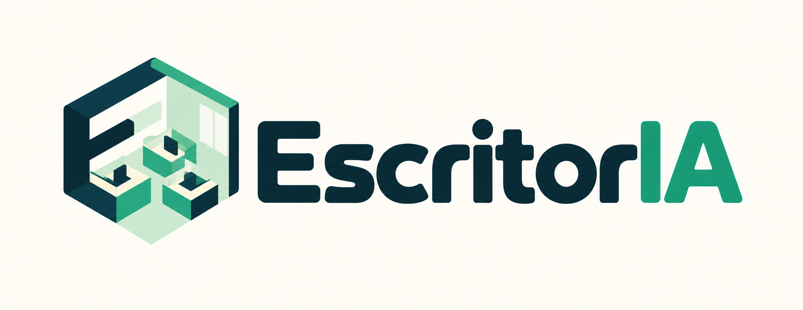
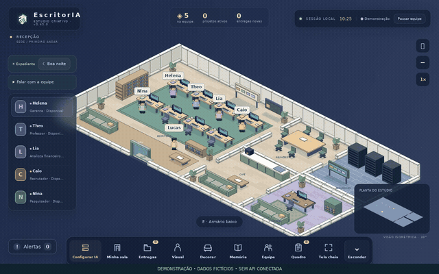
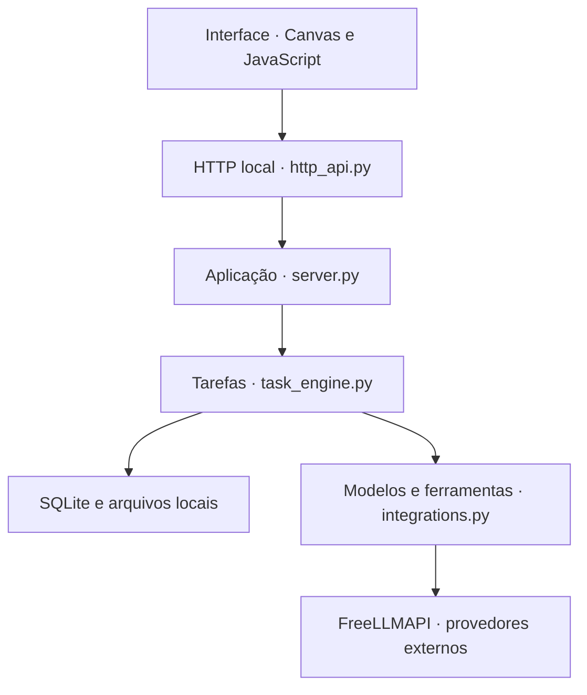

<p align="center"></p>

# EscritorIA

Um escritório virtual local onde você monta uma equipe de IA, distribui projetos e recebe arquivos. O ambiente é 2D isométrico; a aplicação roda no computador e os modelos configurados são acessados pela internet.



*Interface gravada com dados fictícios, sem API conectada. O vídeo não representa uma execução real dos modelos.*

[Vídeo da demonstração](docs/media/escritoria-demo.mp4) · [Configurar integrações](docs/INTEGRACOES.md) · [Gerar o aplicativo Windows](docs/WINDOWS.md)

## O que dá para fazer

- Criar funcionários com qualquer cargo e definir contexto, formação, competências e expectativas.
- Encaminhar um projeto ao gerente, que distribui a execução e revisa as contribuições antes da entrega.
- Anexar arquivos, consultar histórico e guardar resultados e aprendizados em SQLite.
- Personalizar personagens, móveis e a planta do escritório; caminhar pela cidade.
- Habilitar pesquisa, navegação, imagens, edição de vídeo e outras ferramentas por funcionário.

A equipe inicial é um exemplo. Apenas a presença de um gerente é obrigatória; os demais profissionais podem ser editados ou retirados quando não há trabalho pendente. O título do cargo não concede acesso a ferramentas: as permissões são configuradas separadamente.

## Executar

**Windows com Python 3.10 ou superior:** extraia a pasta e abra `Iniciar.bat`. `Primeiro-acesso.bat` cria o atalho da edição de fontes.

Pelo terminal, na raiz:

```bash
python app/server.py
```

Abra o endereço informado no terminal. O servidor aceita conexões locais. Sem chave, o modo de demonstração permite conhecer a interface, mas não produz resultados reais de IA.

Para a janela nativa e o instalador sem Python no computador do usuário, siga [WINDOWS.md](docs/WINDOWS.md). O ZIP de fontes não contém um EXE compilado.

## Configurar a equipe

1. Abra **Configurar IA** e o tutorial da FreeLLMAPI, disponível também em vídeo no app.
2. Cadastre os provedores na FreeLLMAPI. No EscritorIA, informe a chave unificada. Gemini ou Groq são opções de texto; o Cloudflare permanece no roteador para imagens.
3. Em **Equipe**, escreva o cargo e um contexto específico. As sugestões de profissões são apenas atalhos.
4. Em **Minha equipe**, habilite somente as ferramentas necessárias.
5. Escolha **Novo projeto** para pedir uma entrega ao gerente; **Conversar** responde sem iniciar um projeto.

A disponibilidade gratuita depende de cada modelo, conta e cota. Um modelo que entende imagens não necessariamente gera imagens. A ferramenta de navegação permite até duas sessões; as chamadas de IA também têm fila compartilhada. Consulte as limitações em [INTEGRACOES.md](docs/INTEGRACOES.md).

## Arquitetura



O gerente recebe os contextos da equipe e propõe delegações. O backend valida a etapa inicial: não aceita arquivos feitos pelo gerente no lugar dos especialistas. Uma resposta inválida recebe uma tentativa de correção; se persistir, a tarefa pausa com diagnóstico, sem entrega falsa. Após as contribuições, uma tarefa de revisão retorna ao gerente.

## Decisões técnicas

- **Python e HTTP local:** poucos requisitos para executar e integração direta com arquivos, SQLite e ferramentas. A aplicação é local e de usuário único, sem servidor público de contas.
- **SQLite com WAL:** histórico, tarefas e preferências persistem sem instalar um banco separado. Resultados e ações de uma etapa são gravados juntos.
- **Canvas 2D isométrico:** profundidade visual com custo menor que um mundo 3D, considerando computadores sem GPU dedicada.
- **Fila limitada:** dois funcionários podem fazer chamadas remotas ao mesmo tempo; tarefas do mesmo funcionário continuam sequenciais para preservar o contexto.
- **Permissões por ferramenta:** o contexto orienta a profissão, mas não substitui autorização de navegação, código ou publicação.
- **Serviços compartilhados explícitos:** `runtime_context.py` conecta HTTP e tarefas ao estado da aplicação. Os pontos de entrada de `server.py` foram preservados para manter compatibilidade com o desktop e as integrações.
- **Dados fora do executável:** atualização e desinstalação não devem apagar memória, anexos ou credenciais do usuário.

## Organização

```text
app/          aplicação, interface e adaptadores
  web/        jogo, telas, identidade visual e tutorial
  server.py   inicialização, persistência e serviços do escritório
  http_api.py rotas HTTP locais
  task_engine.py contexto, execução e revisão de tarefas
  delegation.py validação de distribuição do gerente
  staff_service.py regras de cadastro e retirada da equipe
tests/        testes Python e JavaScript
docs/         guias atuais e demonstração
examples/     exemplo pequeno de projeto motion
.github/      testes e compilação Windows
```

Capturas antigas e relatórios de versões anteriores foram retirados da pasta de publicação. Os arquivos usados em execução permanecem em `app/web/`.

## Desenvolvimento

```bash
python -m pip install -r requirements-dev.txt
python -m ruff format --check app tests empacotar.py
python -m ruff check app tests empacotar.py
python -m unittest discover -s tests
node --test tests/*.test.cjs
```

No PowerShell, use `node --test (Get-ChildItem tests/*.test.cjs).FullName` se o shell não expandir o curinga.

Os testes de provedores usam respostas controladas; passar nos testes não garante disponibilidade ou cota nas contas externas. A demonstração mostra a interface com dados fictícios e não comprova geração real por IA.

## Preparar uma release

Envie os fontes ao seu repositório e execute a Actions manualmente para conferir a compilação. Depois crie a tag correspondente à versão: `v0.45.0`. A Actions anexa o instalador à release. [Instruções completas](docs/WINDOWS.md).

`dados/`, `config.json`, credenciais, ambientes virtuais e binários de desenvolvimento ficam fora do Git. Para gerar o pacote limpo:

```bash
python empacotar.py EscritorIA-v0.45.0.zip
```

Antes de atualizar uma instalação existente, faça backup e preserve os dados conforme o guia Windows.
