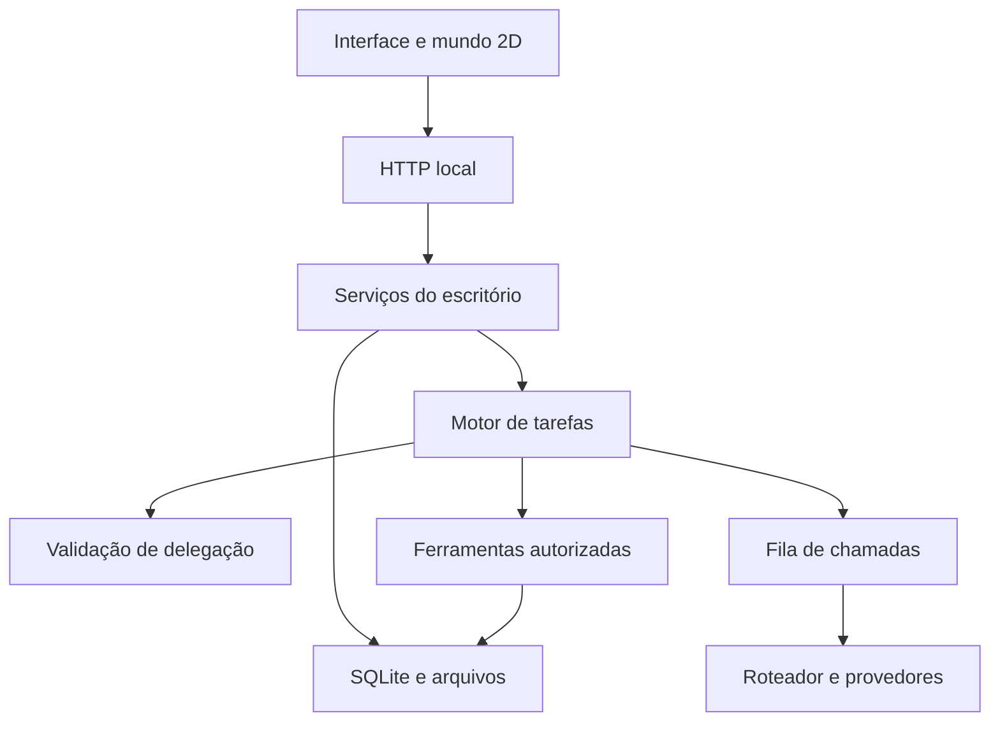

# Arquitetura e decisões técnicas

## Visão geral

O EscritorIA é uma aplicação local de usuário único. Python fornece HTTP, persistência, execução das tarefas e ferramentas; HTML, CSS e JavaScript apresentam o escritório em Canvas 2D. A janela nativa usa o componente web do desktop. Os modelos remotos dependem de internet e das credenciais configuradas na instalação.

O [mapa de arquivos](ESTRUTURA.md) relaciona os módulos. `server.py` mantém a inicialização e serviços compartilhados; `http_api.py` concentra rotas; `task_engine.py` executa tarefas. `runtime_context.py` preserva o acesso ao estado compartilhado durante essa separação. Isso mantém compatibilidade, mas ainda deixa acoplamento que pode ser reduzido em refatorações futuras.

## Fluxo de projeto

1. A interface envia a demanda e as referências ao servidor local.
2. O servidor registra a tarefa no SQLite.
3. Um trabalhador seleciona uma tarefa elegível e verifica o estado do funcionário.
4. O motor monta o contexto, chama a IA e valida as ações propostas.
5. Na etapa inicial de projeto do gerente, `delegation.py` exige delegação válida a um especialista ativo e impede arquivos prematuros. Uma resposta inválida recebe uma tentativa de correção; persistindo, a tarefa pausa.
6. As contribuições dos especialistas levam à revisão do gerente e à entrega final.

Conversa, revisão e subtarefas não são tratadas como o planejamento inicial. O contexto profissional orienta a escolha dos especialistas; não há garantia de que o modelo fará a melhor escolha sem instruções claras e revisão.

## Concorrência e limites

`text_budget.py` implementa a fila compartilhada com capacidade de duas chamadas. Funcionários diferentes podem avançar em paralelo; as tarefas de um mesmo funcionário permanecem sequenciais. A aquisição de tarefas usa transação no banco para impedir seleção concorrente da mesma demanda.

A navegação admite até duas sessões. Sessões de navegador e chamadas ao modelo são recursos diferentes: duas sessões não significam duas chamadas adicionais fora da fila compartilhada.

Os limites de saída variam conforme o fluxo. Aumentar tokens permite respostas maiores, mas não resolve sobrecarga e pode aumentar o tempo de execução. Não existe uma medição universal de complexidade que calcule o orçamento ideal para qualquer pedido.

A fila controla a pressão, não elimina cotas ou latência do provedor. O limite de duas chamadas é uma escolha conservadora, ainda sem um estudo de carga que prove ser o valor ideal.

## Persistência e interrupções

SQLite guarda equipe, tarefas, histórico e preferências. Arquivos de entrada e saída ficam no armazenamento local. Transações agrupam alterações relacionadas. WAL permite melhor convivência entre leitura e escrita, mas não transforma o aplicativo em um serviço multiusuário.

Na inicialização, tarefas deixadas como `executando` são pausadas com aviso para conferir os resultados antes de tentar novamente. Ferramentas e entregas têm suas próprias rotinas de recuperação. Não se promete execução exatamente uma vez em serviços externos.

`failure_center.py` centraliza erros e permite retentativas limitadas para operações consideradas seguras. Publicações e resultados incertos exigem conferência para evitar efeitos duplicados.

## Decisões e consequências

| Decisão | Motivo | Limite |
| --- | --- | --- |
| Aplicação local | Uso no próprio computador e acesso aos arquivos | Precisa estar aberta para trabalhar |
| SQLite | Dispensa instalação de servidor de banco | Arquitetura de usuário único |
| Canvas 2D isométrico | Profundidade com custo menor que um mundo 3D | Renderização e interação precisam de testes visuais |
| Roteador de IA | Centraliza provedores e credenciais de modelos | Disponibilidade depende do roteador e provedores |
| Permissões por ferramenta | Separa papel profissional de acesso técnico | Respostas e ações ainda precisam de validação |
| Compatibilidade dos nomes antigos | Preserva atalhos, dados e atualizações | Alguns nomes internos continuam AtelieIA |

## Limites de confiança

Conteúdo de sites, anexos e respostas de modelos não deve ser tratado como autorização do usuário. O servidor local tem verificações de acesso e origem; não deve ser exposto como servidor público. Segredos e dados pessoais não pertencem ao repositório. Veja [Segurança](../SECURITY.md).

## Evidência de qualidade

Os testes Python e JavaScript verificam regras e respostas controladas. A execução aprovada do commit `8e2439f` está no [GitHub Actions](https://github.com/LucasNobreS/EscritorIA/actions/runs/41242912107). Isso não comprova disponibilidade dos provedores, qualidade de todas as entregas, nem instalação Windows em máquina limpa.
